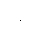

# About
I discovered the idea of growing neural cellular automata
here : https://distill.pub/2020/growing-ca/

Cellular automata theory is a rich field which has been around for some 
time.  The basic idea is that given cells with some initial state and a 
simple update rule can yield interesting and complex behavior.

Neural cellular automata (abbreviated NCA) extends this by having a neural network
function as the update rule, and creating a differentiable environment such that
the NCA is able to learn an update rule that can achieve a desired result.


# Code
- `nca_model.py` - `NeuralCellularAutomata`: the cell state (RGB + alpha + hidden channels),
  the Sobel/identity perception step, the shared per-cell update network, and the training loop.
- `config.py` - all training / inference defaults (dataclasses).
- `viz.py` - GIF saving and playback helpers.
- `main.py` - command line entry point for training (`-t`) and running a trained model (`-e`).

The target image can be any size; the grid is sized to match it. Both modes need `--img` and `--model`.

# Usage
To train an new NCA model, run the following command:
```
python main.py -t --img path-to-img --model path-to-model
```

To run a trained model:
```
python main.py -e --model path-to-model
```
Run the trained model provided:
```
python main.py -e --model saved_models/lizard_best_model.pt --img images/lizard-emoji_40.png
```

# Configuration
Defaults live in `config.py`. Override any value with `--set section.key=value` (repeatable)
or with a JSON file via `--config file.json` containing only the keys to change:
```
python main.py -t --img images/lizard-emoji_40.png --model saved_models/lizard.pt \
    --set train.n_iter=2000 --set train.eval_every=250 --set train.log_every=25
python main.py -e --model saved_models/lizard.pt --img images/lizard-emoji_40.png \
    --set inference.save_gif=out.gif --set inference.display=false
```
During training a full inference is run every `train.eval_every` iterations (0 disables it)
and saved as `iter_XXXXXX.gif` in `train.gif_dir` (default `<model name>_gifs/` next to the model).

# World size
The grid is `model.world_scale` (default 2) times larger than the image in each direction. The image keeps its
size and sits in the centre of an empty world, the seed starts at its centre, and the loss compares the whole
world against that padded target, so growth outside the image is penalised. With `model.norm=none` the update
rule is identical for every cell, and in the default rgba mode the zero padding at the grid edge looks exactly like
empty space, so the cells have no way to tell where the boundary is. Use 2-4; memory use grows with the square of
the scale (pool and backprop), so lower `train.batch_size` if you run out of memory. Do not use
`model.norm=layernorm` with this: its per-position parameters let the model learn where it is in the grid.

# Target image and transparency
In the default rgba mode the loss includes alpha, so a fully opaque image (like `lizard-emoji_40.png`, which has a
solid white background) would make the model learn to draw an opaque square, edges included. To avoid that, a fully
opaque image has its flat background made transparent at load time: pixels within `model.bg_tolerance` (default 0.1)
of the corner colour that connect to the border. Background pockets fully enclosed by the subject stay opaque,
and images that already have transparency are used as they are. Set `model.bg_tolerance=0` to turn this off.

# Exploring cell state
`explore_state.py` runs a trained model for N steps and opens a two-panel dashboard: the generated image on the
left (click any cell), and on the right a colour-coded map of how similar every other cell's state vector is to the
clicked one. Cells that are not alive have no state and are grey. Press `m` to cycle cosine / correlation / Euclidean,
and `n` to compare hidden channels only or all channels (RGBA + hidden). Clicking either panel selects a cell.
```
python explore_state.py --model saved_models/lizard.pt --img images/lizard-emoji_40.png --steps 100 --seed 0
```
Use the same `--set` overrides as training if you changed any model settings (e.g. `model.world_scale`), and
`--save out.png` to write the dashboard to a file instead of opening a window.

# MNIST
`mnist_main.py` / `mnist_nca.py` grow specific MNIST digits (black ink as alpha on a transparent canvas, in a
`model.world_scale` larger world). Each batch comes from a pool of states, and each sample either
- continues from its pool state,
- restarts from a freshly masked digit with part of its ink hidden (the nearest `mask` fraction of ink around a
  random ink pixel). The fraction grows from `mnist.mask_start` to `mnist.mask_end` over `mnist.curriculum_iters`.

Then a fraction of samples (`mnist.p_single_cell`) get a second stage in the same episode: one ink cell of the
grown result is transplanted, at the same position, onto an empty canvas and has to regrow the same digit. Both
stages are in one autograd graph, so the regrowth loss trains the first stage to write the digit's identity into
the cells' hidden state (not just the rule to read it). Second-stage samples cost roughly twice the memory.

The mix is set by `mnist.p_masked` and `mnist.p_single_cell` (25% each by default). MNIST training uses
`mnist.lr_decay_at` (default 12000, after the curriculum) instead of `train.lr_decay_at`. Shared optimisation settings
(`train.*`) and model settings (`model.*`) apply as for the single image. Evaluation GIFs use MNIST test digits;
their rows are target / grown from the masked digit / regrown from a single cell of that result.
```
python mnist_main.py -t --model saved_models/mnist.pt --set train.n_iter=20000 --set model.internal_dim=30
python mnist_main.py -e --model saved_models/mnist.pt --set mnist.eval_mask=0.8
```
MNIST is downloaded to `mnist.data_dir` (default `data/`) on first use. The default is the simplest setup: one
training image each of the digits 1, 2 and 3 (`mnist.classes=[1,2,3]`, `mnist.n_per_class=1`), evaluated on those
same images (`mnist.eval_on_train=true`). To scale up, e.g. `--set "mnist.classes=[]" --set mnist.n_per_class=10
--set mnist.eval_on_train=false` (all classes, 10 each, evaluated on the test set). `mnist.n_images=N` keeps the
first N digits overall when `n_per_class` is 0.

# Matching the original paper
The defaults follow the Distill implementation: no normalisation layer in the update network
(`model.norm=none`), a transparent canvas with a seed whose alpha and hidden channels are 1 and a
premultiplied-RGBA loss (`model.rgba=true`), batch 8 drawn from a 1024-sample pool with the worst sample
reset to the seed each step and a circle erased from 3 others (`train.pool_size`, `train.damage_n`),
per-tensor gradient normalisation, and lr 2e-3 dropping 10x at iteration 2000. Sobel kernels are scaled by 1/8,
and the live-cell mask is applied before and after the update, resetting dead cells to the blank canvas.

Checkpoints trained with the earlier version (global LayerNorm, white RGB canvas) load with
`--set model.norm=layernorm --set model.rgba=false`, but the Sobel scaling and post-update live mask are now
always on, so they will not behave exactly as they did and should be retrained. Closest old training setup:
```
--set model.norm=layernorm --set model.rgba=false --set train.pool_size=0 --set train.batch_size=1 \
--set train.lr=5e-5 --set train.lr_decay_at=0 --set train.normalize_grads=false --set train.n_iter=5000
```
Training saves the best-loss weights to `--model` and the latest weights to `<name>_last<ext>`. With the pool,
"best loss" is a noisy batch statistic, so the `_last` file is usually the one to use.
